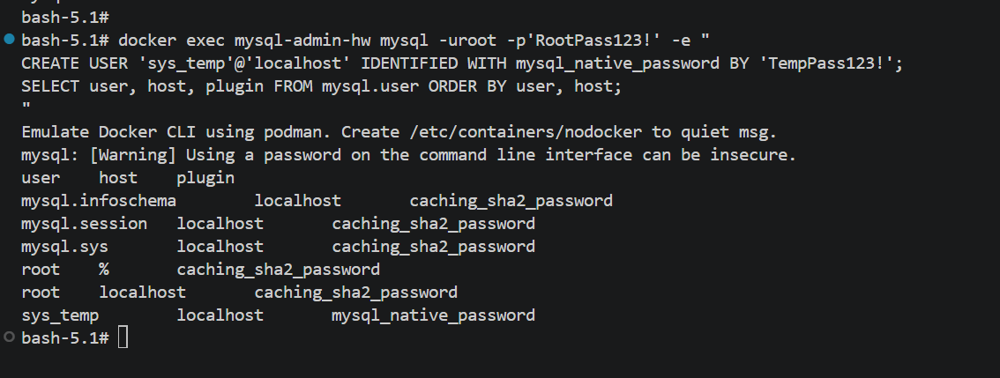
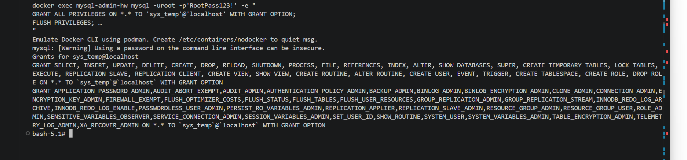
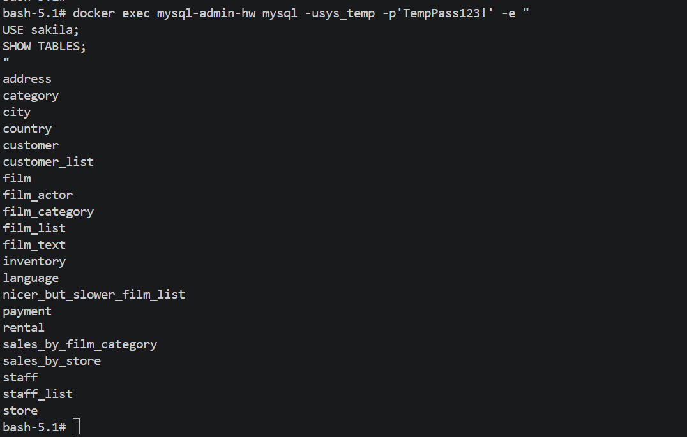
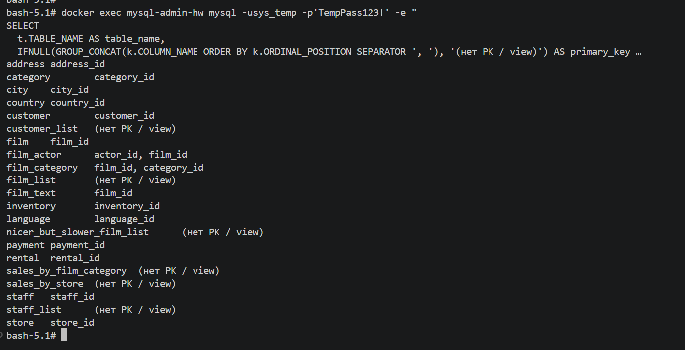

# Домашнее задание к занятию "MySQL Администрирование" - `Дорофеев Максим`

## Задание 1

### 1.1 MySQL 8 в контейнере

Поднят чистый инстанс MySQL 8.0 в контейнере mysql-admin-hw (Podman/Docker).

### 1.2-1.3 Пользователь sys_temp и список пользователей

Создан пользователь sys_temp@localhost с mysql_native_password.

    CREATE USER 'sys_temp'@'localhost' IDENTIFIED WITH mysql_native_password BY 'TempPass123!';
    SELECT user, host, plugin FROM mysql.user ORDER BY user, host;

### 1.4-1.5 Права sys_temp

    GRANT ALL PRIVILEGES ON *.* TO 'sys_temp'@'localhost' WITH GRANT OPTION;
    FLUSH PRIVILEGES;
    SHOW GRANTS FOR 'sys_temp'@'localhost';

### 1.6 Переподключение от sys_temp

    SELECT USER() AS who_am_i, CURRENT_USER() AS auth_as;
    SHOW DATABASES;

Результат: sys_temp@localhost.

### 1.6-1.7 Дамп sakila

Скачан официальный дамп, восстановлен от имени sys_temp:
- sakila-schema.sql
- sakila-data.sql

### 1.8 Список таблиц

    USE sakila;
    SHOW TABLES;

## Задание 2

Таблица: названия таблиц БД sakila и их первичные ключи.

    SELECT
      t.TABLE_NAME AS table_name,
      IFNULL(GROUP_CONCAT(k.COLUMN_NAME ORDER BY k.ORDINAL_POSITION SEPARATOR ', '), '(нет PK / view)') AS primary_key
    FROM information_schema.TABLES t
    LEFT JOIN information_schema.KEY_COLUMN_USAGE k
      ON k.TABLE_SCHEMA = t.TABLE_SCHEMA
     AND k.TABLE_NAME = t.TABLE_NAME
     AND k.CONSTRAINT_NAME = 'PRIMARY'
    WHERE t.TABLE_SCHEMA = 'sakila'
    GROUP BY t.TABLE_NAME
    ORDER BY t.TABLE_NAME;

actor - actor_id
address - address_id
category - category_id
city - city_id
country - country_id
customer - customer_id
customer_list - (нет PK / view)
film - film_id
film_actor - actor_id, film_id
film_category - film_id, category_id
film_list - (нет PK / view)
film_text - film_id
inventory - inventory_id
language - language_id
nicer_but_slower_film_list - (нет PK / view)
payment - payment_id
rental - rental_id
sales_by_film_category - (нет PK / view)
sales_by_store - (нет PK / view)
staff - staff_id
staff_list - (нет PK / view)
store - store_id

